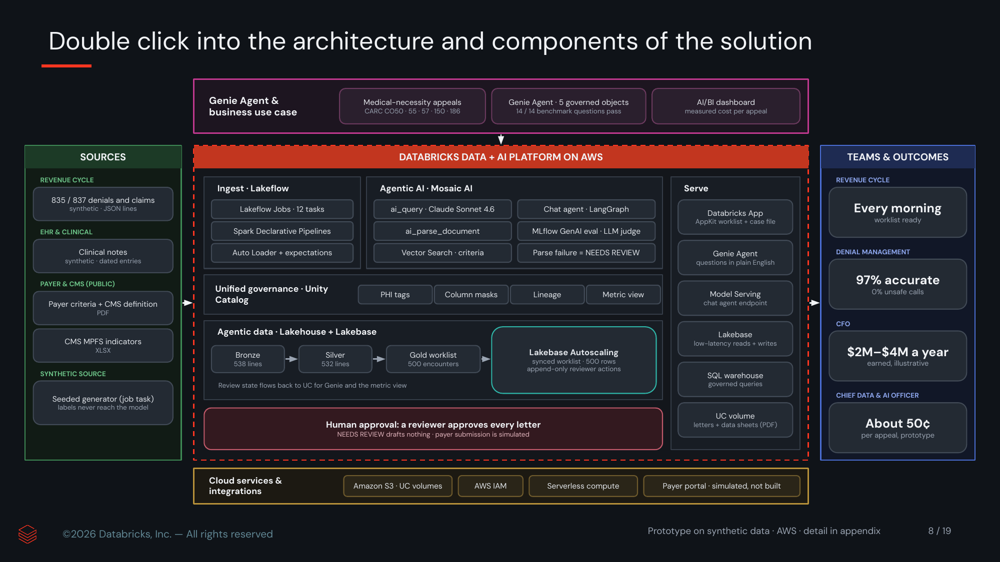
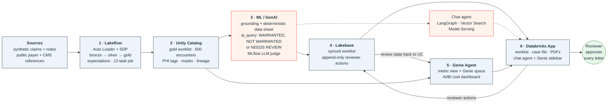
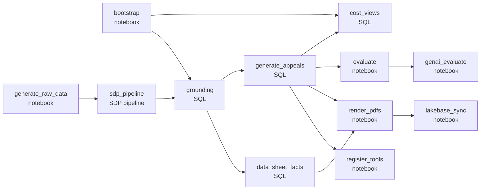

# Medical-necessity appeals on Databricks: FE Bar build

## 1. Business outcome

> **Recover legitimate healthcare revenue, prevent avoidable write-offs and reduce the administrative burden of medical necessity appeals through timely, clinically grounded, AI-assisted appeal preparation.**
>
> **Expected value, to be validated in a pilot:** $2M–$4M a year of earned revenue recovered (Floor to Likely), paying back the pilot within a quarter, even at the floor.

### 1.1 The business problem

A large, multi-state nonprofit health system headquartered in Arizona faces potential revenue leakage when payers deny reimbursement for care already delivered, citing medical necessity. Even when clinical documentation supports the care provided, eligible claims may go unrecovered due to missed appeal deadlines, incomplete supporting evidence and the manual effort required to prepare appeals.

### 1.2 The business objective

The business objective is to recover legitimate reimbursement, reduce avoidable write-offs, accelerate denial resolution and reduce the administrative burden on revenue cycle and clinical teams, while advocating for patients whose medically necessary care has been denied coverage.

### 1.3 What the solution does

The solution evaluates each denial against the patient's clinical record and applicable payer criteria to determine whether an appeal is warranted. When sufficient evidence exists, it generates a clinically grounded appeal letter with dated citations for human review and approval. Cases with insufficient or conflicting evidence are routed for further review without generating an appeal.

The current implementation supports appeal determination and preparation. Payer submission remains outside its scope.

### 1.4 Expected measurable business outcomes

| Business outcome | Success metric | Where it stands today |
|---|---|---|
| Revenue recovery | Incremental annual reimbursement recovered | Model: $2.17M (Floor) to $4.33M (Likely) a year; expected benefit, validated in the pilot (`docs/business_case/MODEL.md`) |
| Revenue leakage prevention | Reduction in avoidable claim write-offs | Pilot measure: write-offs on the pilot payer and code, baseline vs pilot window of equal length |
| Timely appeals | Percentage of eligible appeals prepared before filing deadlines | Prototype: the worklist ranks denials by expected dollars × deadline risk and flags NEW and AT_RISK cases first; the percentage is a pilot measure |
| Operational efficiency | Reduction in appeal preparation time | Not measured in the prototype; the pilot times preparation per appeal |
| Workforce productivity | Administrative and clinical hours saved | Model: about 1,832 admin hours a year, roughly 1.0 FTE, at Floor and Likely (`DECK_NUMBERS.md` §3) |
| Financial performance | Reduction in cost per appeal | Model at Floor: about $57 labour per appeal before, about $29 after (labour + platform). Platform cost: $1.30 (Floor) / $1.05 (Likely) per appeal at health-system scale; $0.51 measured on the prototype |
| Patient advocacy | Reduction in avoidable patient financial liability, where applicable | Pilot measure; the prototype makes no patient-outcome claim |
| Clinical integrity | Percentage of appeal determinations supported by clinical evidence | Prototype, synthetic data: 98.3% groundedness and 96.7% no fabricated evidence (LLM judge, 60 rows); 97.2% agreement with designed labels and 0% unsafe calls (180 rows) |

**Patient advocacy, not clinical outcomes.** The build addresses post-service denials, so its patient benefit is financial protection: less avoidable patient financial liability and a better billing experience. It makes no clinical-outcome claims. Revenue recovery is an expected benefit until a production pilot validates it.

### 1.5 The value case

Annual incremental recovery by tier (`docs/business_case/DECK_NUMBERS.md` §1, §3, §6). The headline range is Floor to Likely on the top-down method. The bottom-up cross-check is lower and is shown, not hidden.

| Tier | Top-down, $M/yr | Bottom-up cross-check, $M/yr | What drives the tier |
|---|---|---|---|
| **Floor** | 2.17 | 1.16 | Sourced base rates only |
| **Likely** | 4.33 | 1.16 | Floor × 2.0 dollar weighting. **The 2.0× is an assumption, not sourced.** |
| **Ceiling** | 8.65 | 9.74 | Top of sourced rates. The bottom-up Ceiling also uses an unsourced 85% improved appeal rate (`docs/business_case/MODEL.md`). |

**Caveats that travel with the numbers**
- **Likely depends on the 2.0× multiplier.** At 1.5× the top-down Likely is $3.25M; at 3.0× it is $6.50M (DECK_NUMBERS §1).
- **Bottom-up does not converge with top-down in the Likely case.** Its Floor and Likely are both $1.16M. The gap comes from the $465 average denied amount.
- **Payback and returns use placeholder costs.** The one-time pilot and implementation cost is $216K (Floor) or $144K (Likely and Ceiling); annual run cost is $90K or $60K. Both are assumptions to validate with the health system's revenue cycle team. At Floor, payback is 1.3 months top-down and 2.5 months bottom-up, both after the one-time cost. The 20.2× top-down figure is net benefit ÷ annual cost ("annual return on run cost") and excludes the one-time cost; the year-1 return including the pilot at Floor is about 6×.
- **Cost per appeal is platform cost, at list price.** About $1 at health-system scale ($1.30 Floor, $1.05 Likely, `DECK_NUMBERS.md` §3); $0.51 fully loaded and $0.11 variable measured on the prototype at 60 appeals a day (`evidence/10_cost_per_appeal.md`). Both exclude people cost and the health system's contracted rates.
- **The $12.8M starting hypothesis is a placeholder, not a result.** At Floor rates it would need a 5.9× dollar multiplier. The model does not support it.

### 1.6 What the prototype has proven (synthetic data only)

On 180 generated encounters, the determination matches the designed label 97.2% of the time (175 of 180). It made no unsafe WARRANTED call (0.0%). All five misses went to NEEDS REVIEW, which is the safe direction (`evidence/11_eval_180.md`). The end-to-end job ran three times in a row, 10 of 10 tasks each time, growing the worklist from 60 to 120 to 180 appeals without regenerating finished ones (`evidence/08_job_run.md`). The eval measures agreement with designed labels. It does not measure payer overturn rates.

### 1.7 Who it serves and the next step

**Stakeholders** (roles, per `docs/STAKEHOLDERS.md`): CFO (executive sponsor), VP of Revenue Cycle (domain owner), Director of Denial Management (operational owner) and Chief Data & AI Officer (technical stakeholder).

**Proposed next step.** A 90-day pilot on one payer and one denial code (BCBS of Arizona commercial, CO50), with baseline and pilot windows of equal length, measuring the outcomes in 1.4. Pilot cost is a placeholder in this build ($144K–$216K for 12 weeks, the one-time cost behind the payback figures), to be scoped with the health system (`docs/deck/DECK.md`, slides 11–12).

**Deck.** The executive deck, "Automate the Appeal. Recover the Revenue." (`docs/deck/FE_Bar_Medical_Necessity_Appeals_POV.pdf`), tells this story in a 12-slide main section plus seven appendix slides; figure sources per slide are in `docs/deck/DECK.md`.

---

## 2. The integrated data journey

One hero claim runs through all six stages. The claim is **Elena Marquez** (fictional): keys `101 / 770000001 / 50000001`, BCBS of Arizona commercial, CPT 27447-RT (total knee arthroplasty), CARC CO50, charges $58,400, expected reimbursement $24,850. Denied 2026-06-07. Appeal deadline 2026-12-04, which is 9 days after the 2026-11-25 run date. The designed determination is WARRANTED.

**Stage 1: Lakeflow (ingest and transform).**
- The generator is a job task (`pipeline/10_generate_raw_data.py`). It writes JSON lines to the UC volume `landing` (`claims/`, `clinical_notes/`).
- The eval labels go to the Delta table `eval_case_labels` only. They never reach the landing area, the pipeline or the model.
- The SDP pipeline `fe-bar-appeals-sdp` (`sdp/01`–`04`) runs Auto Loader into `bronze_claims` (538 lines) and `bronze_clinical_notes` (1,053 notes). A full refresh on an empty landing folder fails, so the generator must land a batch first (`evidence/01_lakeflow_pipeline.md`).
- Silver expectations drop 6 defect lines (2 invalid CARC `CO97`, 2 dates of service after denial, 2 null keys). They warn on 2 negative reimbursements.
- Gold `gold_denial_worklist` has one row per encounter: 500 rows. It is ranked by expected dollars × deadline risk. The hero is rank 1, `AT_RISK`, 9 days remaining.
- Source: `evidence/01_lakeflow_pipeline.md`.

**Stage 2: Unity Catalog (governance).**
- All objects are in `appeals_hackathon_catalog.fe_bar_appeals`. Gold and silver tables have column comments.
- PHI tags are on patient name, date of birth, MRN, member ID and claim ID. Base tables carry `synthetic=true`.
- Lineage is read from `system.access.table_lineage`. It shows bronze → silver → gold → grounding → `appeals_output` → `worklist_serving`.
- Reviewer grants are written (`governance/02_reviewer_grants.sql`) but not yet applied. They need an account-level group.
- Source: `evidence/02_governance.md`.

**Stage 3: ML/GenAI (determination and letter).**
- `encounter_grounding` builds one digest per encounter. It injects the payer-routed criteria passages (`med_nec_criteria`, routed by `denial_strategy`), the MPFS coding context, and the dated notes. The Vector Search index `med_nec_criteria_index` serves the chat agent, not the batch.
- `data_sheet_facts` is built by plain SQL with no LLM. It has one row per grounded (non-past-due) encounter: 450 in the latest run (the count moves daily as deadlines pass). Each one renders a rule-built data sheet.
- `appeals_output` gets one `ai_query` call per encounter (`databricks-claude-sonnet-4-6`). It writes with MERGE, capped at 60 per run, hero first, then `NEW`, then priority rank.
- The output is exactly one of WARRANTED, NOT WARRANTED or NEEDS REVIEW. Any unparseable response becomes NEEDS REVIEW with a `PARSE_FAILURE` reason.
- The hero is WARRANTED. Its letter quotes dated notes (`evidence/04_genai_generation.md` §5a).
- Evaluation joins `eval_case_labels` in `pipeline/60_evaluate.py` only and writes `eval_results` and `eval_summary`.
- The MLflow GenAI judge (`pipeline/65_genai_evaluate.py`) scores stored generations with `databricks-claude-sonnet-4-6`. It covers 60 rows, the most recent generations. The full 180 is not run because it exceeds the $5 cost cap. Figures are in §5.

**Stage 4: Lakebase (operational serving and review).**
- `worklist_serving` (Delta, change data feed on) is synced to a Lakebase Autoscaling database as the synced table `fe_bar_appeals.worklist_serving`. It has 500 rows. The app reads it at low latency.
- Reviewer actions are inserted into `public.review_actions`. The table is append-only, so the app cannot update or delete events. The actions are EDIT, APPROVE, REJECT, ROUTE_TO_REVIEW and SUBMIT.
- `public.review_state` gives the latest status per encounter. For the hero, that is APPROVE then SUBMIT (simulated), with `deadline_met = t`.
- Source: `evidence/03_lakebase.md`.

**Review loop: back to Unity Catalog.** The review state is copied into the Delta table `review_state_uc`, using the UC catalog `fe_bar_appeals_lakebase`. Genie and the metric view can then query it (4 rows at the latest sync; simulated). Source: `evidence/03_lakebase.md`, `evidence/08_job_run.md`.

**Stage 5: Genie Agent (natural-language access).**
- The Genie Agent space "FE Bar – Medical Necessity Appeals" (`01f1e7ec913217158b231c3e2f18fa20`) uses five objects: the metric view `appeals_metrics`, `appeals_output`, `eval_summary`, `gold_denial_worklist` and `review_state_uc`.
- `appeals_metrics` defines appealable revenue, revenue at deadline risk, revenue lost to deadline, warranted rate, NEEDS REVIEW rate, approval rate and cost per appeal.
- 14 of 14 benchmark questions passed, grouped by stakeholder role. One of them is "What is the status of the claim for Elena Marquez?" The 2026-11-25 re-run on the 180-row state passes all 14 (`evidence/07_genie.md`).

**Stage 6: Databricks App (business surface).** `fe-bar-appeals-app` (AppKit). The worklist is sorted with NEW first, then priority, and carries NEW, AT_RISK and PAST_DUE tags. Recommendation chips show a count for each outcome. A "≥ $10K expected" toggle and an expected-$ sort narrow the list. The case file opens the letter, the data sheet and the AI worksheet together. The edited letter has a preview with "Show changes" and a PDF download in the browser. A full-height assistant sidebar holds the chat agent (`fe-bar-appeals-chat`, a LangGraph `ResponsesAgent` over UC functions and the VS index) and the Genie tab. Reviewers can take actions (`evidence/06_app.md`, `evidence/09_chatbot.md`).

**Demo path for the hero.** Worklist (rank 1, AT_RISK, 9 days) → case file → letter and data sheet → Approve → Submit (simulated) → Genie question on the claim's status → chat question on the evidence.

---

## 3. Architecture

### 3.1 Reference architecture

The detailed architecture from the deck (slide 8): sources, the Databricks platform layers, and the teams and outcomes each layer serves.



### 3.2 Data flow by FE Bar stage

One path from synthetic sources to a reviewer's approval, with the review loop back through Lakebase into Unity Catalog and Genie. Table- and task-level detail for each stage is in §2.



### 3.3 Job DAG (`fe-bar-appeals-job`, defined in `resources/fe_bar_appeals.job.yml`)

Generated from the job definition (task keys, task types and `depends_on`), so it matches what the bundle deploys.



- The job has 12 tasks. `genai_evaluate` (`pipeline/65_genai_evaluate.py`) runs after `evaluate`, and `cost_views` refreshes the cost-dashboard views. The three 10-task runs in `evidence/08_job_run.md` predate both.
- The job is a Databricks Asset Bundle. Python tasks run on serverless compute. SQL tasks run on the shared SQL warehouse.
- Retries: 1 to 2 per task. The generation MERGE is incremental, so a retry does not re-bill finished rows.
- The schedule is a daily cron at 04:00 America/Phoenix, **PAUSED** to control cost.
- The job runs the repo's own code. The older UI-built job in the earlier prototype is not used.

### 3.4 Auth model

| Path | Identity | Why |
|---|---|---|
| Worklist read, review actions | **App service principal**, through a Lakebase Postgres role | Lakebase is not governed by UC OBO. The SP is granted SELECT on the worklist, and SELECT and INSERT on `review_actions`. It has no UPDATE or DELETE, so reviewer events are append-only. |
| Appeal letter, data sheet, PDFs (UC volume), reads from UC | **Signed-in user (OBO)** | The app forwards the user's token. Reads are governed by each reviewer's UC grants, so column tags and least-privilege grants apply per user. |
| Chat | **Signed-in user (OBO)** calling the endpoint | The endpoint's service principal needs EXECUTE on the UC functions and SELECT on the VS index. Never `CREATE OR REPLACE` those functions behind a live endpoint: it breaks the passthrough. |
| Genie tab | **App service principal** (CAN_RUN on the space, SELECT on its five objects) | The forwarded user token never carried the `genie` scope, even after a scope change and redeploy. The Genie tab therefore runs as the SP. Trade-off: Genie answers reflect the app's access, not each reviewer's grants. |
| Job tasks | The identity that deploys the bundle (no `run_as` set) | Simplest for a demo. Production would use a service principal. |

**Column masks (governance).** `mask_phi` and `mask_phi_ts` (`governance/05_column_masks.sql`) are attached to seven PHI columns: `appeals_output.patient_name`, `data_sheet_facts` (name, member ID, DOB text) and `encounter_grounding` (name, member ID, DOB). The masks survive the grounding rebuild, which was verified on 2026-11-26. Members of the workspace group `fe-bar-appeals-reviewers`, and the app service principal, see real values. Everyone else sees `***MASKED***`, or NULL for DOB. The job and the chat endpoint run as the group member, so they keep real values. Lakebase copies, appeal PDFs and SDP-managed tables are not masked (`evidence/13_column_masks.md`).

---

## 4. Decisions and trade-offs

**Declarative `ai_query` batch, not an agent loop, for generation.** Each encounter gets one fixed call. The control flow is deterministic and the cost is bounded: 60 calls per run. The outputs are reproducible and easy to evaluate. The trade-off is no dynamic tool choice and no follow-up turns. The one place that needs those is the chat agent, which is a LangGraph `ResponsesAgent` over UC functions (`evidence/04_genai_generation.md`, `evidence/09_chatbot.md`, `evidence/10_cost_per_appeal.md`).

**Deterministic data sheet, not an LLM worksheet, as the trust artifact.** `data_sheet_facts` is built by SQL from the source rows. It covers every grounded encounter, has no cap, and makes no LLM call. The reviewer checks the letter against it. The LLM worksheet is kept as a separate PDF labelled "AI reasoning (model-generated)" and is produced only in the capped batch. The trade-off is that the rules must be maintained by hand (`SPEC.md` ADDENDUM 1).

**Generator as a job task → landing volume → Auto Loader, not generation inside the pipeline.** The ingest step is visible in the job run and the raw files can be inspected. The trade-off: Auto Loader ignores files rewritten at the same path, so re-landing a batch needs a full refresh of the pipeline (`docs/FINDINGS.md`).

**Ground truth kept out of the data path.** Designed labels are written only to `eval_case_labels`. The model never sees them. The trade-off is that accuracy measures agreement with designed cases, not payer outcomes.

**Lakebase Autoscaling, not Provisioned, for serving.** The project runs at 0.5 CU with a 300-second suspend (`evidence/03_lakebase.md`). Reviewer actions are an append-only native table, which keeps the audit trail. The worklist is a synced copy, so it refreshes on the job's `lakebase_sync` step rather than live. Postgres keys are uppercase and must be quoted. The trade-off is that the copy can lag the Delta table until the next run.

**Incremental generation with a 60-per-run cap.** A MERGE keys on an `input_hash`. The candidates are rows with no output or a changed hash. The order is hero, then `NEW`, then priority rank. The run log shows 60 rows written and 0 updated in each of three runs, so no finished letter is regenerated (`evidence/04_genai_generation.md` §2). The trade-off is backlog: 450 encounters are grounded at the latest run (the count falls as deadlines pass) and 180 are generated so far. The grounding step is incremental: a digest cache (`encounter_digest_cache`) means each encounter is summarised once, and later runs only re-summarise changed notes (`evidence/08_job_run.md`).

**Genie through the app service principal.** The OBO token did not carry the `genie` scope, so the Genie tab runs as the app SP. The trade-off is that Genie shows the app's access, not per-reviewer grants. The worklist and review actions already run as the SP. PDFs and chat stay on OBO. I approved this on 2026-11-24.

**Public appeal windows, labelled as assumptions.** Commercial 180 days (29 CFR 2560.503-1), Medicare Advantage 65 days (Medicare.gov, 42 CFR 422.582), and Medicaid 60 days (A.R.S. §36-2903.01, AHCCCS only). These are member-appeal floors used as proxies. Provider-contract windows vary and are often shorter. The Medicaid alternative of 12 months is not modelled (`data/SOURCES.md`, `docs/SPEC.md` ADDENDUM 2).

**Workspace group, not account group, for the reviewer persona.** `fe-bar-appeals-reviewers` is a workspace group. It holds the app CAN_USE permission and the Genie CAN_RUN permission. UC grants need an account-level group, which does not exist yet, so the reviewer grant set is written but not applied. The trade-off is that reviewers' UC reads depend on grants that are not yet set up for the group (`docs/FINDINGS.md`).

**Column masks through the workspace group, with an app SP exemption.** Masks test `is_member('fe-bar-appeals-reviewers')` and `session_user()` against the app SP id, and return the real value for either. Other principals see `***MASKED***` (NULL for DOB). `is_member` checks workspace-local groups, which is why the workspace group is used. The trade-off: the group name and SP id are hard-coded in the function, and the non-member branch is verified at logic level only (`evidence/13_column_masks.md` §5). The Databricks docs say `IS_ACCOUNT_GROUP_MEMBER` and `SESSION_USER` run as the invoker. They do not name `is_member`, so that behaviour is unconfirmed. Masks on `encounter_grounding` survive the stage-20 rebuild (verified 2026-11-26: grounding task re-run, masks still listed in `information_schema.column_masks`).

**LLM judge with the generator's context, and a cost cap.** The MLflow evaluation (`genai_evaluate`) scores stored generations with `databricks-claude-sonnet-4-6`. Its groundedness context is rebuilt from the generator's own prompt blocks and is drift-tested against `pipeline/30_generate_appeals.sql` (`genai/eval_logic.py`). An earlier context that omitted claim identifiers marked correct letters as ungrounded (83.3% before the fix, 98.3% after). The job refuses any run whose estimated judge cost exceeds `genai_cost_cap_usd`, which defaults to $5. The 180-row run is estimated at about $7.2, so only 60 rows were judged. The trade-off: the judge and the generator are the same model family (`evidence/14_mlflow_genai_eval.md`).

**No payer contracts.** Contract terms are not in the data and are not invented. Each data sheet prints "Payer contract terms: not reviewed (not available in this build)" (`pipeline/25_data_sheet_facts.sql`). Contracts are future state.

**New job and new schema, old resources untouched.** The earlier prototype's job, endpoint, app and schema are not changed. The trade-off is duplicated setup for anyone who wants to run both.

---

## 5. Evidence index

**Start with [`evidence/00_LIFECYCLE.md`](evidence/00_LIFECYCLE.md):** the build mapped to design → build → test → validate → deploy, and every enhancement found by testing (root cause → fix → evidence).

Full index with stage mapping and real-or-simulated labels: **[evidence/EVIDENCE.md](evidence/EVIDENCE.md)**.

### Where it runs (live workspace)
Everything below is deployed and can be opened directly in the workspace (requires access to the FEVM workspace
[`fevm-appeals-hackathon`](https://fevm-appeals-hackathon.cloud.databricks.com/browse?o=7474656043998914)). IDs match `databricks bundle summary` and the evidence files.

| Resource | ID / link | What it shows |
|---|---|---|
| Unity Catalog schema | [`appeals_hackathon_catalog.fe_bar_appeals`](https://fevm-appeals-hackathon.cloud.databricks.com/explore/data/appeals_hackathon_catalog/fe_bar_appeals?o=7474656043998914) | Bronze/silver/gold tables, grounding, appeals output, metric view, PHI tags, column masks, lineage |
| Lakeflow Job (bundle) | [`211997391364769`](https://fevm-appeals-hackathon.cloud.databricks.com/jobs/211997391364769?o=7474656043998914) | 12-task DAG defined as code |
| Job runs of record | [`317191832078218`](https://fevm-appeals-hackathon.cloud.databricks.com/jobs/211997391364769/runs/317191832078218?o=7474656043998914), [`107638099811940`](https://fevm-appeals-hackathon.cloud.databricks.com/jobs/211997391364769/runs/107638099811940?o=7474656043998914), [`813247927527653`](https://fevm-appeals-hackathon.cloud.databricks.com/jobs/211997391364769/runs/813247927527653?o=7474656043998914) | Three full runs, all SUCCESS: incremental 60 → 120 → 180 appeals (`evidence/08_job_run.md`) |
| | [`263358598052015`](https://fevm-appeals-hackathon.cloud.databricks.com/jobs/211997391364769/runs/263358598052015?o=7474656043998914) | MLflow GenAI judge run (`evidence/14_mlflow_genai_eval.md`) |
| | [`120234699538992`](https://fevm-appeals-hackathon.cloud.databricks.com/jobs/211997391364769/runs/120234699538992?o=7474656043998914) | Live verification after parameterizing the bundle: 12/12 SUCCESS, counts unchanged (`evidence/17_bundle_clean_run.md`) |
| Lakeflow SDP pipeline | [`4873b47b-47a7-4081-97c0-7cdf018c71a1`](https://fevm-appeals-hackathon.cloud.databricks.com/pipelines/4873b47b-47a7-4081-97c0-7cdf018c71a1?o=7474656043998914) | Auto Loader + expectations, bronze → silver → gold (`evidence/01_lakeflow_pipeline.md`) |
| Lakebase | project `fe-bar-appeals-lakebase`, synced table [`worklist_serving`](https://fevm-appeals-hackathon.cloud.databricks.com/explore/data/fe_bar_appeals_lakebase/fe_bar_appeals/worklist_serving?o=7474656043998914) | Synced worklist + append-only reviewer actions (`evidence/03_lakebase.md`) |
| Genie space | [`01f1e7ec913217158b231c3e2f18fa20`](https://fevm-appeals-hackathon.cloud.databricks.com/genie/rooms/01f1e7ec913217158b231c3e2f18fa20?o=7474656043998914) | Appeals metrics in plain English, 14/14 benchmarks (`evidence/07_genie.md`) |
| AI/BI dashboard | [Appeals Automation Agent Insights](https://fevm-appeals-hackathon.cloud.databricks.com/dashboardsv3/01f1e968adcd1e3b93920b557b986458/published?o=7474656043998914) | Cost per appeal from `system.billing` (`evidence/15_cost_dashboard.md`) |
| Chat agent endpoint | [`fe-bar-appeals-chat`](https://fevm-appeals-hackathon.cloud.databricks.com/ml/endpoints/fe-bar-appeals-chat?o=7474656043998914) | LangGraph agent on Model Serving (`evidence/09_chatbot.md`) |
| Databricks App | [`fe-bar-appeals-app`](https://fe-bar-appeals-app-7474656043998914.aws.databricksapps.com) | Worklist, case file, chat and Genie (`evidence/06_app.md`) |

The smoke-target runs (`308145351572869` and duplicates) ran in an isolated schema that was destroyed after verification; they are recorded in `evidence/17_bundle_clean_run.md`.

| What | Where | Key result |
|---|---|---|
| Pipeline update and expectations | `evidence/01_lakeflow_pipeline.md` | 6 of 538 defect lines dropped; 500 gold encounters |
| Governance | `evidence/02_governance.md` | PHI tags; lineage bronze → gold → appeals_output → worklist_serving |
| Lakebase | `evidence/03_lakebase.md` | 500-row synced worklist; append-only reviewer events |
| Generation | `evidence/04_genai_generation.md` | 60 per run, 0 rewrites; sample WARRANTED, NOT WARRANTED, NEEDS REVIEW outputs |
| End-to-end job | `evidence/08_job_run.md` | 3 of 3 full runs SUCCESS (10 of 10 tasks each, before `genai_evaluate` and `cost_views` were added; the job now has 12); 180 appeals: 72 WARRANTED, 66 NOT WARRANTED, 42 NEEDS REVIEW |
| Eval, 180 encounters | `evidence/11_eval_180.md` | 97.2% accuracy (175 of 180); 0.0% unsafe; 0 parse failures |
| App API responses | `evidence/06_app.md` | Worklist, case file and review round trip return 200 or 201 |
| Genie Agent | `evidence/07_genie.md` | 14 of 14 benchmark questions (180-row state, 2026-11-25) |
| Chat agent | `evidence/09_chatbot.md` | Hero question answered with dated evidence |
| Cost per appeal | `evidence/10_cost_per_appeal.md` | $0.11 variable; $0.51 fully loaded at 60 per day (list price) |
| Column masks | `evidence/13_column_masks.md` | Member reads real PHI; no masked values in the reviewer view. Non-member path is logic-only |
| GenAI eval (MLflow judge) | `evidence/14_mlflow_genai_eval.md` | 60 rows: groundedness 98.3%, no fabricated evidence 96.7%, determination match 95.0%; quotes 89.7% normalised / 58.7% strict |
| Cost dashboard | `evidence/15_cost_dashboard.md` | "Appeals Automation Agent Insights" (AI/BI): cost by component, per appeal and at volume; $0.52 fully loaded at 60/day (dashboard view; the billing measurement in `evidence/10` is $0.51), $0.24 at 180/day, $0.14 at 600/day (list price) |
| Deck | `docs/deck/DECK.md`, `docs/deck/FE_Bar_Medical_Necessity_Appeals_POV.pdf` | Deck v2: 12-slide main story plus appendix (19 pages), figure sources per slide |
| Python tests | `generator/tests`, `genai/` | 202 passed (local run) |
| App tests | `app/` (Vitest) | 73 passed |

Business-case numbers are in `docs/business_case/DECK_NUMBERS.md`.

---

## 6. How I used AI

I used **Claude Code and Isaac** throughout the build. Claude Code helped me coordinate the implementation, testing, debugging and evidence collection. I also used Isaac while building and reviewing the solution and the Google Slides deck, including slide construction, rendering and visual checks. I supplied the customer context, made the architecture and business decisions, tested the live application and decided what needed to change.

I started from a problem raised in a discovery conversation: the denial-management team was rebuilding medical-necessity appeals by searching across claims, clinical notes and payer criteria. I wanted to show an automated morning worklist, not a chatbot waiting for someone to type a prompt. I also required a deterministic data sheet beside each AI-drafted letter so a reviewer could check the facts quickly. If the evidence was missing or conflicting, the workflow had to return `NEEDS REVIEW` and produce no letter.

I kept four audiences in mind. The VP of Revenue Cycle cares about revenue and filing deadlines. The Director of Denial Management needs a practical work queue. The CFO needs to understand cost, assumptions and payback. The CDAIO needs to see that the design is governed and reusable. I shaped the deck around those questions instead of walking through a list of Databricks products. It starts with the business problem, follows one fictional denial through the workflow, shows what was actually measured and ends with a 90-day pilot request.

The platform design was intentional. The generator and Auto Loader feed Spark Declarative Pipelines; Unity Catalog provides lineage, tags, grants and masks; `ai_query` makes the determination and drafts the supported letter; Lakebase serves the worklist and stores reviewer actions; review state returns to Unity Catalog; Genie exposes the operational metrics; and the Databricks App brings the worklist, case file, chat and analytics together. I used one hero denial through the full flow so I could demonstrate that these were connected parts of one solution.

Before implementation, I approved a shared plan and interface contract in `docs/SPEC.md`. Parallel workstreams used `docs/FINDINGS.md` to record blockers and interface changes, and each track had to produce text evidence. I used Databricks AI Dev Kit guidance for pipelines, jobs, Lakebase, Genie, Apps, Unity Catalog, AI Functions and Asset Bundles. My working rules were straightforward: public references and synthetic data only, leave the earlier prototype untouched, cap generation at 60 appeals per run, fail safely, ask before changing access, and do not put a number in the README or deck unless it traces to evidence.

The first outputs were not automatically accepted. I used the application and reported what did not work: the `NEEDS REVIEW` explanation overflowed, the case-file dialog was hard to use, an edited letter did not visibly update, chat returned a 403, Genie had a scope problem and the assistant input still sat below the fold after the first UI fix. I asked for those problems to be corrected and retested. The resulting application has a clearer worklist, a usable case file, letter comparison and download, a full-height assistant panel, working permissions and server-side filters for recommendation and expected value.

I made the same kinds of calls outside the UI. I chose to anonymize the customer. I approved the required grants and later removed a broad `account users` grant. I asked why the bundle still had hard-coded names and whether it could really deploy from scratch. That led to a parameterized bundle, an isolated smoke target, a successful 12-task clean deployment and teardown, a 12-task live verification run with unchanged counts, and a final no-op plan.

Testing also changed the build. A laterality problem in the synthetic data was fixed and covered by a regression test. A SQL failure caused by an apostrophe led to a static quote check. A missing Lakebase column was found after the app returned a 503. Grounding was changed to use a content-hash cache. The first LLM-judge run scored groundedness at 83.3% because the judge did not see the same context as the generation model. I required the contexts to match and a drift test to be added; groundedness then measured 98.3%.

I also pushed back on the business case and presentation. I treated the original `$12.8M` opportunity as a hypothesis. The research did not support it as stated, so I did not use it as the result. I chose Floor, Likely and Ceiling scenarios, kept the lower bottom-up cross-check visible, labelled the Likely tier's `2.0×` weighting as an assumption and included the pilot cost in the payback calculation. I rejected an earlier title and asked for the deck to be rebuilt when it looked unpolished and disjointed. The final title, **"Automate the Appeal. Recover the Revenue."**, reflects both the operational and financial value.

The final prototype reports 97.2% accuracy across 180 synthetic appeals, no unsafe calls, 98.3% LLM-judged groundedness, 96.7% no-fabrication performance and 14 of 14 Genie benchmark answers. Measured cost is `$0.11` variable and about `$0.51` fully loaded per appeal at 60 per day. The current code passes 202 Python tests and 73 application tests. These are prototype results on synthetic data, not payer outcomes or realized revenue.

The evidence for how I worked is in [`docs/PROMPT_LOG.md`](docs/PROMPT_LOG.md), [`docs/STEERING_LOG.md`](docs/STEERING_LOG.md) and [`evidence/00_LIFECYCLE.md`](evidence/00_LIFECYCLE.md). The Claude Code session IDs are `e2e3204c-874a-4e35-bf06-2aa699e64087` (the build) and `b0cc9995-d83b-4627-b4ee-eed4b81318ec` (bundle parameterization, the clean run, and the final README and deck passes).

I did not use another FE's submission or another person's code for this submission.

---

## 7. Limitations and what is simulated

**Simulated**
- All patients, claims, notes, member IDs, facilities and eval labels come from `generator/` (seed `20261124`). They are fictional. Payer names are routing labels.
- Reviewer actions are recorded as `demo-reviewer (simulated)`. The hero's APPROVE and SUBMIT are simulated. SUBMIT is an app status, not a payer submission.
- `review_state_uc` and the approval-rate measure in Genie use simulated actions.
- The data sheet's "payer contract terms not reviewed" line is a fixed statement, not a review.

**Not implemented**
- Payer submission. Payer contracts. Prior-authorization appeals. Multi-payer expansion (P2 future state).
- Row filters. Column masks cover only the PHI columns listed in `evidence/13_column_masks.md`.
- Reviewer UC grants (written, not applied; needs an account-level group).
- The full 180-row LLM-judge run. The judge scored 60 rows; the 180-row estimate (about $7.2) is above the $5 cap.
- Chat-agent tracing. `fe-bar-appeals-chat` has tracing enabled, but no traces were found in either experiment (`evidence/14_mlflow_genai_eval.md` §8b).
- A live nightly schedule. The job is paused.
- A recorded browser visual test of the app. The evidence holds API calls, the 73 Vitest tests and a build.

**Limits of the numbers**
- Accuracy is agreement with designed labels on synthetic cases. It is not a payer win rate and not a clinical outcome.
- The quote check is a metric only. On 180 rows, 85.3% of quoted spans match after normalising punctuation and 54.7% match verbatim (`evidence/11_eval_180.md`). On the 60-row judge run the figures are 89.7% and 58.7% (`evidence/14_mlflow_genai_eval.md`). The strict gap comes from PDF-extraction artefacts in the criteria text and from genuine paraphrase. Quotes are a weak proxy for groundedness, so the two are reported together.
- The LLM judge covers 60 of 180 rows. Groundedness is 98.3%, no fabricated evidence 96.7%, and determination match 95.0%. Single verdicts can flip between runs (`evidence/14_mlflow_genai_eval.md` §5, §9). Read a sample before relying on a rate.
- Column masks: the non-member path is verified at logic level only. Lakebase copies, appeal PDFs and SDP-managed tables are unmasked. The chat tool `get_encounter` reads `encounter_grounding` and has not been re-tested for non-members.
- Financial figures are model outputs on public benchmarks and labelled assumptions. The one-time and run costs are placeholders. The 2.0× dollar weighting behind Likely is unsourced.
- Cost figures are list price, this workspace's usage only. Warehouse and pipeline shares are allocations.
- The appeal windows rest on public regulations, with the caveats above. The BCBS criteria file is a secondary summary; its underlying AZ Blue sources are cited in `data/SOURCES.md`.
- The hero's letter is in the repo only as an excerpt. The full letter and data-sheet PDFs are not committed.

---

## About this repo

**About this repo.** This build extends my earlier appeals prototype. It is a new repository. The private repo `naveen-sangana_data/med-nec-appeals-fe-bar` has the full history. The public mirror `nsangana/med-nec-appeals-fe-bar` holds snapshots of the final tree without the private history. It builds in a new schema, `appeals_hackathon_catalog.fe_bar_appeals`, under new resource names (`fe-bar-appeals-*`). The earlier schema, job, endpoint and app were not modified and are not referenced here.

**Scope.** Synthetic data only. Public reference documents only. Every prototype metric is labelled "prototype, synthetic data". Stage names follow the FE Bar: Lakeflow, Unity Catalog, Lakebase, ML/GenAI, Genie Agent, Databricks App.

---

## Running it

**Prerequisites.** Databricks CLI v1.21 or later with a profile for the workspace, plus `jq`, `psql` and `python3`. The workspace needs Unity Catalog with serverless compute, a SQL warehouse, a Vector Search endpoint named `appeals-vs-endpoint`, and Lakebase Autoscaling. `databricks.yml` hard-codes the build workspace host and warehouse, so change `targets.default.workspace.host` and `variables.warehouse_id` for another workspace. Set `FEBAR_PROFILE` and `FEBAR_WAREHOUSE` if they differ from the defaults.

**Deploy from a clean checkout.** One runbook covers the whole build:

```
scripts/deploy_all.sh --dry-run          # print every step, run nothing
scripts/deploy_all.sh                    # validate, deploy, then the idempotent setup steps in order
scripts/deploy_all.sh -t smoke --dry-run # the smoke target (see Targets below)
```

The runbook runs, in order: `bundle validate` and `bundle deploy`; the Lakebase project and DDL (`lakebase/setup_lakebase.sh`); one full job run (this creates the tables the later steps read); the Lakebase synced table (`lakebase/create_synced_table.sh`) and the review view; governance `01` and `05`; the Genie metric view (`genie/00`, `genie/01`) and a redeploy; the chat agent (`agent/build_and_deploy.py` as a one-time serverless run); the app (workspace import, `apps update` with the full definition in `app/app_resources.json`, `apps deploy`); governance `04`; and a final `bundle plan`. `governance/02_reviewer_grants.sql` is not run because it needs an account-level group.

**Targets and variables.** `databricks.yml` parameterizes the names (`name_prefix`, `lakebase_project`, `lakebase_catalog`, `vs_endpoint`, `chat_model`, `max_appeals`, `enable_lakebase_sync`, the dashboard and Genie titles and the JSON file paths), so defaults reproduce the live names exactly. Two targets:
- `default`: the live build, with no prefix. It deploys every resource. The Lakebase, chat endpoint, registered model and VS index are declared in `targets/default/*.yml` (under `targets.default.resources`), so they do not exist in the smoke target.
- `smoke`: schema `fe_bar_appeals_test`, names `fe-bar-appeals-smoke-*`, `max_appeals` 5, `enable_lakebase_sync` false, its own `root_path`. It deploys only the schema, volumes, SDP pipeline, job, dashboard and Genie space. Deploy it with `databricks bundle deploy -t smoke`; `bundle plan -t smoke` shows eight creates.

The dashboard and Genie exports hard-code the source catalog and schema, and bundle variables are not substituted inside JSON. `scripts/render_configs.py --catalog C --schema S --out build/<target>/` rewrites them (dataset `catalog`/`schema` keys and dotted `catalog.schema` references). With the source names the output is byte-identical to the source, which the default target uses directly. `build/` is git-ignored and is regenerated by the runbook (step 1) before each validate or deploy. To validate or plan smoke by hand, run `scripts/render_configs.py --catalog appeals_hackathon_catalog --schema fe_bar_appeals_test --out build/smoke` first.

**What the bundle owns.** `bundle plan` reports no changes on these: the job (including the `cost_views` task) and the SDP pipeline, the dashboard "Appeals Automation Agent Insights", the Genie space, the schema and the three volumes, the Lakebase project, branch, endpoint, `appeals` database, UC catalog and synced table, the registered chat model, the VS index, and the chat endpoint. The app is not in the bundle. Its own definition is `app/databricks.yml`, and `app/app_resources.json` is what the runbook applies. Roles, grants and the Lakebase owner role are also outside the bundle. Full inventory and plan output: `evidence/16_bundle_deploy.md`.

**Things to know.**
- The job is PAUSED on its schedule, so the runbook's step 3 is the only run. Run it on the morning of a demo, because NEW tags and days-remaining are date-relative.
- On a brand-new workspace the first `bundle deploy` can fail on the chat endpoint until agent version 2 is registered. The runbook warns and continues, and the second deploy (after the agent step) creates the endpoint.
- To run one task: `databricks bundle run fe_bar_appeals_job --only <task>`. Use `+` to include upstream tasks.
- `genie/build_space.py` and `genie/genie_space.json` are superseded by the exported space in `genie/appeals_metrics.geniespace.json`, which the bundle owns.

**Tests.** `python3 -m pytest generator/tests genai/` runs the generator, parser, evaluation and parameterization tests (202 Python tests). In `app/`, `npm run test` runs the Vitest suite (73 app tests).

A clean data-layer rerun was done on 2026-11-25: landing volume, PDFs and job-owned tables were reset and regenerated; schema, grants and resources were kept. The full refresh and the three job runs are in `evidence/01_lakeflow_pipeline.md` and `evidence/08_job_run.md`. The rerun itself changed no code and no grants. The code-review fixes and the app redeploy landed before it.

---

## Repo layout

```
databricks.yml, resources/      bundle: variables, targets, job, SDP pipeline, dashboard, Genie space, schema, volumes
targets/default/                default-target-only resources: Lakebase, chat endpoint, model, VS index;
                                guards.yml (delete protection for live resources only)
                                (see the 'What the bundle owns' list)
scripts/deploy_all.sh           the runbook (-t default|smoke; validate, deploy, setup steps in order; --dry-run)
scripts/render_configs.py       renders the dashboard and Genie JSON into build/<target>/ (catalog.schema rewrite)
dashboards/                     Lakeview dashboard JSON and cost_views.sql (cost views, run as a job task)
generator/                      seeded synthetic generator, writer, unit tests
sdp/                            Lakeflow SDP source: bronze, silver, gold, reference MVs
pipeline/                       job tasks: bootstrap, raw data, grounding, data sheet, generation,
                                PDFs, Lakebase sync, evaluation
genai/                          output parser, judge-context logic, tests (parser, eval, SQL quotes, parameterization)
agent/                          chat agent (LangGraph ResponsesAgent) build and deploy
lakebase/                       setup script, DDL, grants, synced-table helper, auth notes,
                                APP_GRANTS.md (current grant and binding status)
governance/                     PHI tags, reviewer grants, lineage query, app SP grants
genie/                          metric view, exported Genie space JSON (bundle-owned), benchmarks and runner
app/                            Databricks App (AppKit): server, client, tests
tools/                          run_sql.py helper (parameterised SQL)
data/SOURCES.md                 public references and appeal-window sources
docs/                           SPEC, FINDINGS, STAKEHOLDERS, CUSTOMER_CONTEXT, SESSION_LOG,
                                business_case/ (model, sources, cost checkpoints, DECK_NUMBERS),
                                deck/ (DECK.md text map, deck PDF, architecture slide image + spec)
evidence/                       execution evidence as text, indexed in evidence/EVIDENCE.md
```
